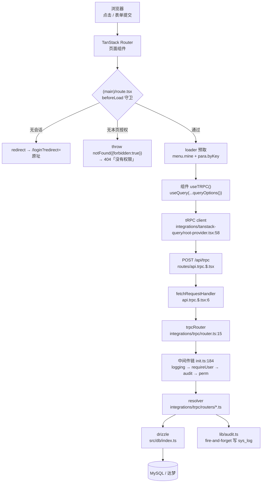

# 后端代码导读

> 这份文档只干一件事:**让你能顺着它把后端代码读完**。
> 不讲业务需求,只讲「代码在哪、谁调谁、为什么这么写」——每一条都指到具体文件与行。
>
> 配套:`doc/后端接口约定.md`(写接口时的规矩)、`doc/rbac-权限模型.md`(权限三层)、
> `doc/数据库与认证.md`(表与迁移口径)、`doc/已知陷阱.md`(踩过的坑)。

后端一共 **212 个 `.ts`/`.tsx`**(含前端组件),其中真正的后端面:

| 层 | 规模 | 入口 |
| --- | --- | --- |
| tRPC 接口 | **12 个 router / 71 个 procedure**(25 query + 46 mutation) | `src/integrations/trpc/router.ts:15` |
| 数据访问 | drizzle + 两张 schema,一套类型跑 MySQL 与达梦 | `src/db/index.ts:58` |
| 横切 | 日志 / 审计 / 权限 / 数据权限,各一个文件 | `src/lib/{logger,audit,rbac,data-policy}.ts` |
| HTTP 端点 | **只有两个** | `/api/trpc`、`/api/auth/*` |

---

## 0. 三分钟地图:一次请求走完整条链



两条容易看漏的线:

- **SSR 期间的 tRPC 调用是"服务端 fetch 自己"**(走 `http://localhost:PORT/api/trpc`),
  所以要靠一个自定义 fetch 把浏览器的 cookie 带过去 —— `root-provider.tsx:45` 的 `trpcFetch`,
  用 `createIsomorphicFn` 写(换成 `typeof window === "undefined"` 分支会被构建期拦下来)。
- **审计是 fire-and-forget**:`void writeAudit(...)`,业务永远不等它(`init.ts:127`)。

---

## 1. 目录结构:每一层是什么角色

```
src/
├── routes/                    ← HTTP 入口:页面 + 两个 api 端点(见 §3)
│   ├── __root.tsx             ← 根:404/403 页面、主题引导脚本、Toaster、devtools
│   ├── login.tsx              ← 唯一一个不在 (main) 下的页面
│   ├── api.trpc.$.tsx         ← 端点①:tRPC(20 行,只做转发)
│   ├── api/auth/$.ts          ← 端点②:Better Auth(带自己的日志包装)
│   └── (main)/                ← 整个后台外壳;route.tsx 是守卫 + 布局
├── integrations/trpc/         ← tRPC 本体
│   ├── init.ts                ← ★ 中间件链 + procedure 工厂(后端第一站)
│   ├── router.ts              ← 12 个命名空间的拼装
│   ├── routers/*.ts           ← 12 个业务 router,2744 行
│   └── react.ts               ← 客户端 context(4 行)
├── integrations/tanstack-query/
│   └── root-provider.tsx      ← ★ tRPC link / QueryClient / SSR 脱水注水
├── db/
│   ├── index.ts               ← ★ 按 DATABASE_URL 选方言,导出唯一 db
│   ├── data-base-schema.ts    ← 19 张系统表(不进迁移)
│   ├── schema.ts              ← 只有示例表 todos(走迁移)
│   └── dm/                    ← 达梦适配(rewriteForDm)
├── lib/                       ← 28 个文件,3715 行;没有 UI,大部分能单测
└── components/                ← 纯前端,见 doc/界面约定.md
```

**后端阅读顺序建议**:`integrations/trpc/init.ts` → `router.ts` → 挑一个 `routers/*.ts`
→ `db/index.ts` + `data-base-schema.ts` → `lib/` 里被它引用的那几个。

`components/`、`hooks/`、`styles.css` 是前端面,本文不展开。

### 12 个 router 与它们管什么

`src/integrations/trpc/router.ts:15` 一张表说清了(命名空间 → 表):

| 命名空间 | 管的数据 | 文件 |
| --- | --- | --- |
| `log` | `sys_log`(只读) | `routers/log.ts`(92 行) |
| `notice` | `sys_notice`(只碰自己的) | `routers/notice.ts`(103) |
| `demoGrid` | `demo_grid`(行级数据权限落点) | `routers/demo-grid.ts`(164) |
| `menu` | `sys_menu` | `routers/menu.ts`(232) |
| `dict` | `sys_dict` | `routers/dict.ts`(136) |
| `para` | `sys_para`(旧名 `sys_config`) | `routers/para.ts`(160) |
| `tag` | `sys_tag` + `sys_tag_relation` | `routers/tag.ts`(366) |
| `department` | `sys_dept` + 成员/角色分配 | `routers/department.ts`(281) |
| `role` | `sys_role` + `casbin_rule`(`p` / `g` 行) | `routers/role.ts`(262) |
| `user` | `sys_user` + 部门/角色分配 | `routers/user.ts`(273) |
| `file` | `sys_file`(字节在 MinIO) | `routers/file.ts`(299) |
| `policy` | `sys_data_policy` | `routers/data-policy.ts`(376) |

> 注意最后一行的**命名空间与文件名不一致**:文件叫 `data-policy.ts`,挂载名是 `policy`
> (`router.ts:39`)。照文件名找接口会找不到,这是刻意给的短名。

---

## 2. 设计理念:十二条,每条都有代码位置

### ① 横切关注点挂在中间件上,不靠每个 resolver 记得写

`init.ts:182-188` 定义了两个 procedure 工厂,业务代码只用这两个:

```ts
export const publicProcedure = t.procedure.use(loggingMiddleware).use(auditMiddleware);
export const protectedProcedure = t.procedure
	.use(loggingMiddleware).use(requireUser).use(auditMiddleware).use(permMiddleware);
```

于是「每次后端调用都有日志」「每个写调用都进审计」「每个接口都过权限表」是**结构性保证**。
两个中间件(`loggingMiddleware` / `auditMiddleware`)还被 `tests/logging.test.ts` 拿去做同一性断言 ——
回归用例守着这件事,而不只是注释里的一句话。

### ② 权限按 **path 查表**,不在 resolver 里手写权限码

`init.ts:153` 的 `permMiddleware` 拿 `path`("menu.create")去查 `PERM_BY_PATH`(`lib/rbac.ts:279`,71 条)。
漏登记一个接口不会"静默放行"——`tests/auth.test.ts` 的分类守卫会失败,强迫你把它归到
`PERM_BY_PATH` 或 `UNMAPPED_MUTATIONS`(`rbac.ts:386`)/ `UNMAPPED_QUERIES`(`rbac.ts:405`)之一。

表里一个值可以是一个码,也可以是**一组码**(命中任一即放行),后者给被多个页面共用的读接口用:
比如 `role.list` 同时被角色页 / 用户页 / 部门页 / 数据权限页使用,写死一个会把别的页面打死。

### ③ 客户端与服务端共用"纯逻辑"文件,服务端模块绝不进客户端包

这是本仓库最容易踩、也最执拗的一条。三条硬规则:

1. **要进浏览器的文件不许有服务端依赖**。`lib/para-spec.ts` 顶部直接写着
   「⚠️ 这个文件里不允许出现 `db` / `drizzle` / 任何服务端依赖」;`lib/data-policy-spec.ts`
   同口径(它是纯逻辑,`lib/data-policy.ts` 才是碰库的那半)。
2. **`trpcRouter` 的"值"只被 `routes/api.trpc.$.tsx` 引用**,客户端全用 `import type TRPCRouter`。
   所以 routers 及其依赖不会进客户端包 —— 见 `lib/current-user.ts:4-6` 的解释。
3. **路由文件(`routes/**`)里必须动态 import 服务端模块**。`(main)/route.tsx:36-40` 用
   `Promise.all([import("#/lib/auth"), ...])`;`root-provider.tsx:45` 用 `createIsomorphicFn`。
   违反的表现不是 typecheck 报错,而是浏览器里 `Cannot read properties of undefined (reading 'prototype')`
   —— `Buffer.prototype` 不存在,整个应用崩掉。

### ④ 数据库访问只从 `src/db/index.ts` 出去

`db/index.ts:28` 按协议前缀选驱动(`dm://` → 达梦,`mysql://` → mysql2),但
**导出的 `db` 只有一种类型**(`db/index.ts:54-58`):两条线底层都是 drizzle 的 `MySqlDatabase` +
同一个 schema,所以达梦实例结构上就是 MySQL 的替身。好处是 routers / 页面 / 测试一行都不用改,
类型也不会退化成联合类型。

`db/index.ts:49` 在启动时打一行 `db.dialect` 日志。**为什么值得一行日志**:换了 `DATABASE_URL`
但没重启进程时,服务会继续连旧库(Vite 的 env 热重启不会重跑 dotenv),症状是"账号/数据莫名其妙找不到"
—— 这个信息骗过我们两次。

### ⑤ 两张 schema 文件,口径不同,不要混

`src/db/schema.ts` 顶部那段注释是权威说明:

- **19 张系统表**在 `db/data-base-schema.ts`:**只声明读写的形状,不进迁移**(库里已存在,进了会报 1050);
  真正的 DDL 由 `scripts/create-system-tables.ts`(MySQL)和
  `scripts/create-better-auth-tables-dm.ts`(达梦)维护。
- **`db/schema.ts` 只放示例表 `todos`**,`drizzle.config.ts` 只指向它 —— `pnpm db:generate` / `db:migrate` 管这里。

18 张表的分组(照 `schema.ts` 注释):系统设置五张(`sys_menu` / `sys_dict` / `sys_para` / `sys_tag` /
`sys_tag_relation`)+ 认证四张(`sys_user` / `sys_session` / `sys_account` / `sys_verification`)+
权限五张(`sys_dept` / `sys_role` / `sys_user_dept` / `sys_data_policy` / `casbin_rule`)
+ `sys_file` / `sys_log` / `sys_notice` + 示例表 `demo_grid`。

两条硬约定:**Better Auth 四表的模型名/字段名不可改**(adapter 键必须是 `user` / `session` /
`account` / `verification`),改了 typecheck 抓不到、运行时报"找不到字段";
认证四表用 `created_at`/`updated_at`,系统设置表用 `create_time`/`update_time`。

### ⑥ 时间只在一处处理

`lib/time.ts` 顶部:`Date.prototype.toISOString()` 输出 UTC,当"给人看的时间"用在 UTC+8 下**差 8 小时**。
全项目的时间格式化/解析都收口到这一个模块。

### ⑦ 平铺行 → 树只留一份实现

`lib/tree.ts`:`以前这套逻辑在项目里存在五份`(菜单导航 / 菜单管理 / 部门 / 标签 / 权限树),
每份各写一遍"按 parentId 分组 + 同级排序 + 递归",于是**各自漏了不同的东西**。现在只有一份。

### ⑧ 多值字段只有一个分隔符口径

`lib/multi-value.ts`:多值(标签)字段既被渲染层消费(`ui/badge-list.tsx`),也被表单与 Excel 写回收口,
所以解析逻辑只能有一处。

### ⑨ 统一编号而不是自增序号

`lib/ids.ts`:编号 = `前缀-YYMMDD-HHMMSS`(如 `ENT-260920-153045`)。**可读**(一眼看出什么时候建的)
是第一理由。主键另用 nanoid(21 位),见各 router 的 create。

### ⑩ 参数不写死在代码里

`lib/sys-para.ts`:保留天数、同步开关、侧边栏收起形态这类东西"改一次不该发一次版",
所以存 `sys_para`,并带一个 **30 秒内存缓存**(任务/执行器要频繁读它)。
「界面偏好」那类(`page.columns` / `page.tree` / `page.size`)走 `hooks/use-para-prefs.ts`,
是**使用者的偏好**而不是这台机器的偏好 —— 换台电脑还是自己那套。

### ⑪ 抽象分两层:纯逻辑 + 碰库

| 纯逻辑(客户端可引) | 碰库(仅服务端) |
| --- | --- |
| `lib/data-policy-spec.ts`(主体/资源怎么写、合不合法、编译成可见集合) | `lib/data-policy.ts`(读 `sys_data_policy` 灌 Casbin、把可见集合落成 SQL) |
| `lib/para-spec.ts`(类型码、校验、默认值形状) | `lib/sys-para.ts` |
| `lib/menu-spec.ts`(菜单类型码与文案) | `routers/menu.ts` |
| `lib/audit.ts`(动作名/目标描述/该不该记) | 真正挂链的是 `init.ts` 的 `auditMiddleware` |

### ⑫ 实现文件刻意扁平命名

`lib/storage-minio.ts` **不**放成 `lib/storage/minio.ts`:`storage.ts` 与 `storage/` 同名会让
`#/lib/storage` 同时指向文件和目录,`tsc` 与 Nitro 的 ESM 解析各选一边,**运行时才报错**。
`lib/storage.ts` 因此只被 `storage-minio.ts` 动态 import。

---

## 3. 公共路由:对外入口全集

### 3.1 HTTP 端点只有两个

| 端点 | 文件 | 内容 |
| --- | --- | --- |
| `/api/trpc/*` | `routes/api.trpc.$.tsx`(20 行) | GET + POST 都进 `fetchRequestHandler({ router: trpcRouter, endpoint: "/api/trpc" })`。**没有任何业务逻辑**,日志/权限全在中间件里 |
| `/api/auth/*` | `routes/api/auth/$.ts`(66 行) | Better Auth 全量端点。因为 TanStack 的 server handler **不走 tRPC 中间件**,这里自己包了一层日志 |

`api/auth/$.ts` 的日志规则值得单独记(`$.ts:14-24`):

- `SKIP = new Set(["get-session", "session", "ok"])` —— **会话轮询不记**,否则每次页面加载都刷一条,把别的日志淹掉;
- `sign-in*` 一律收敛成 `auth.sign_in`;登录失败打 `auth.failed`(warn);
- 端点名放在 `endpoint` 字段 —— `event` 是日志自己的保留名(`ts`/`level`/`event`),不能借;
- **不记请求体**,只从 body 里摘 `email` 一个字段(脱敏靠"只取这一个",不靠事后过滤)。

### 3.2 页面路由(22 个)

| 路径 | 文件 | 说明 |
| --- | --- | --- |
| `/login` | `routes/login.tsx` | 唯一在 `(main)` 之外 |
| — | `routes/(main)/route.tsx` | **(main) 的布局 + 守卫**,不是页面 |
| `/` | `(main)/index.tsx` | 工作台 |
| `/notices` | `(main)/notices.tsx` | 通知中心 |
| `/blank` | `(main)/blank.tsx` | 空白页 |
| `/demo/{table,grid,form/simple,store,drizzle,better-auth,tanstack-query}` | `(main)/demo/*.tsx` | 7 个框架能力样例 |
| `/settings` | `(main)/settings/index.tsx` | 设置总览 |
| `/settings/{users,roles,departments,menus,dictionary,parameters,tags,logs,files,data-policy}` | `(main)/settings/*.tsx` | 10 个真实 CRUD 页 |

### 3.3 守卫是三层,别只做第一层

| 层 | 位置 | 拦什么 |
| --- | --- | --- |
| ① 页面级(SSR) | `(main)/route.tsx:64` 的 `beforeLoad` | 无会话 → `redirect("/login?redirect=原址")`;有会话但无本页授权 → `notFound({forbidden:true})` |
| ② 接口级 | `init.ts:153` `permMiddleware` | 按 `path` 查 `PERM_BY_PATH`,不命中抛 `FORBIDDEN` |
| ③ 行级(数据) | `lib/data-policy.ts` | 把可见集合编译进 `where(...)`,见 `doc/rbac-权限模型.md` |

第①层的两个设计决定,都是踩过才定的:

- **判权限必须在服务端**(`(main)/route.tsx:26-31`):客户端 `authClient.useSession()` 是异步的,
  首帧渲染不出结论 —— 未登录用户会先看到后台外壳再被弹走,既闪屏又等于把外壳白送出去。
- **"没权限"走 not-found 通道,不是错误边界、也不是 redirect**(`(main)/route.tsx:48-55`):
  框架对**任何错误边界都写死 `status: 500`**,想给 4xx 就只能走 not-found(`status: 404`);
  `redirect` 会把用户甩到另一个地址(URL 变了,像走错门);顺带还不暴露"这个地址存在"。
  页面本身在 `__root.tsx:79` 的 `NotFound`,按 `data.forbidden` 分清「没权限」与「地址不存在」两种 404。

> ⚠️ `__root.tsx:71` 的 `forbiddenDataOf` 读的是 `notFound({ data })` 里那个**普通对象**,不是错误实例。
> 别改成 `instanceof`:错误对象要序列化给客户端做水合,`prototype` 会丢(踩过)。

---

## 4. tRPC 接口层

### 4.1 四道中间件(`init.ts`,196 行,后端第一站)

按 `protectedProcedure` 的执行顺序:

| 顺序 | 中间件 | 行 | 干什么 | 关键细节 |
| --- | --- | --- | --- | --- |
| 1 | `loggingMiddleware` | `:30` | 每次调用记 3 行(debug 起 / 完成或失败 / 慢 warn),统一带 `traceId`/`path`/`type`/`ms` | 入参只在 debug 级记且经 `sanitize()` 脱敏;超过 `LOG_SLOW_MS`(默认 1500)打 `trpc.slow` |
| 2 | `requireUser` | `:84` | 没用户抛 `UNAUTHORIZED` | `ctx.user` **直调 caller 注入的优先**;HTTP 路径没有 `createContext` ⇒ 注入这条路**从网络不可达** |
| 3 | `auditMiddleware` | `:105` | 只对 mutation 写 `sys_log` | `void writeAudit(...)` fire-and-forget;**只写一次**(见下) |
| 4 | `permMiddleware` | `:153` | 查 `PERM_BY_PATH` | `user?.isSuper` 直接放行;`perms === null`(菜单表为空 = 权限体系未启用)也放行 |

**`next()` 在 resolver 报错时不抛,而是 resolve 成 `{ ok: false, error }`** —— 这是本层最大的坑,
两个中间件都踩过:

- `init.ts:38-46`(日志):不判它就会出现"调用失败却记成 ok"的假日志;
- `init.ts:98-101`(审计):不判它失败会被记成两条。

同一个坑在客户端侧也有一份说明:`doc/已知陷阱.md`。

`requireUser` 的注入设计(`init.ts:77-93`)顺带解释了测试为什么能免去造角色授权:
测试注入一个 `isSuper` 用户,而网络路径永远拿不到 `ctx.user`。

### 4.2 resolver 里怎么拿当前用户

用 `currentUserOf(ctx)`(`init.ts:173`),它做的是**类型收紧**(把 `ctx as {user}` 转换收成一处),
并再兜一次 `UNAUTHORIZED`。读会话本身的实现在 `lib/current-user.ts:34` 的 `getCurrentUser()`,
它**吞掉"没有请求上下文"的异常** —— 脚本/单测直调 procedure 时,"没有用户"就是正确结论,
该由 `requireUser` 拒绝,不该在这里炸成 500。

### 4.3 procedure 形状

71 个 procedure = 25 query + 46 mutation。列表接口有**四种形状**(详见 `doc/后端接口约定.md` §四):

| 形状 | 例 | 何时用 |
| --- | --- | --- |
| 裸数组 | `role.list` | 前端全量拿 |
| 裸数组 + limit | `log.recent` | 只要前 N 条 |
| `{ rows, perms }` | `menu.list` | 列表 + 权限点目录一起给 |
| `{ total, items }` | `tag.objectsOfTag` | **全仓唯一一处**分页形状 |

入参批量的上限用 `.max(...)`,全仓出现 117 次;最严的是 `policy.create` 的叉积
(`subjectIds ≤ 200 × scopeIds ≤ 50`)。

### 4.4 权限表怎么读

`PERM_BY_PATH`(`rbac.ts:279`)分两段,中间有注释分隔:

- **写接口段**(上半):`"menu.create": "sys:menu:add"` —— 一个 path 一个码;
- **读接口段**(下半,`:324` 起):值是**数组**,`pagePermOf("/settings/roles")` 之类。
  `lib/rbac.ts:63` 的 `pagePermOf(路径)` 合成页面码 = "这个页面的菜单勾上了"。
  数组语义:**这些页面里任意一个可见就放行**。

没有登记的接口只要求登录,由 `tests/auth.test.ts` 的分类守卫盯着。

---

## 5. 数据层

### 5.1 入口

`db/index.ts:19-24`:`DATABASE_URL` 缺失时**在模块导入期就抛错**(不是等到第一次查询),
所以依赖库的页面会落到路由错误边界,而不是页面内那个"数据库不可用"的降级面板。

### 5.2 达梦适配

`src/db/dm/` 把 drizzle 生成的 MySQL 方言 SQL 改写成达梦能吃的形状(`rewriteForDm`)。
注意 `db/index.ts:10-11`:达梦分支需要 `NODE_OPTIONS=--openssl-legacy-provider`(dmdb 用了老算法),
`.npmrc` 里加 `node-options=--openssl-legacy-provider` 可以一劳永逸。差异与坑见 `doc/达梦支持.md`。

### 5.3 脚本

`scripts/` 里与库结构相关的:

| 脚本 | 作用 |
| --- | --- |
| `create-system-tables.ts` | 19 张系统表的 MySQL DDL + 已建库环境的 ALTER 注册表 |
| `create-better-auth-tables-dm.ts` | 达梦侧的认证四表 |
| `sync-table-meta.ts` | 只对齐**列注释与索引名**(不动类型/宽度) |
| `seed-*.ts` | 种子:`menus` / `dicts` / `paras` / `policies` / `rbac` / `tags` / `demo` |
| `migrate-ids-to-nanoid.ts` | 历史主键迁移 |

> ⚠️ 已知缺口:`create-system-tables.ts` 的 `create table if not exists` **永不修改已存在的表**,
> 而 ALTER 注册表只覆盖"加列/删列/改注释"。**列宽、列类型、外键动作规则都不会被对齐** ——
> 旧库与 DDL 漂移时不会有任何提示。详见 `doc/已知陷阱.md`。

---

## 6. 横切关注点

| 关注点 | 实现 | 入口 |
| --- | --- | --- |
| 日志 | `lib/logger.ts`(唯一出口,结构化 JSON) | 中间件 `init.ts:30` 打 3 行;业务用 `logger.debug/info/warn/error` |
| 审计 | `lib/audit.ts`(纯逻辑)+ `init.ts:105`(挂链) | 写 `sys_log`,失败也绝不抛 |
| 权限并集 | `lib/rbac.ts`(角色 → 菜单/按钮) | `effectiveMenusFor(userId)` `rbac.ts:163`、`canViewPath` `rbac.ts:176` |
| 行级数据权限 | `lib/data-policy.ts`(Casbin 判决策 + 编译成 SQL) | 30s TTL 缓存 `CACHE_TTL_MS` |
| 错误归一化 | `lib/api/error.ts`(`toApiError`) | 任意错误 → `ApiError`,便于统一 toast / 表单回显 |
| 参数 | `lib/sys-para.ts`(30s 缓存) | 见 §2⑩ |

**事务只在 5 个 router 里出现**(见 `doc/后端接口约定.md` §八)。产品代码在事务里显式删子表 ——
`department.remove` 有成员时抛 `PRECONDITION_FAILED`,`user.remove` 先删 session/account/m2m,
**不依赖数据库的 `on delete cascade`**。这一点很重要:活库 MySQL 的 8 条外键实际是 `NO ACTION`,
而 schema 里写的是 `cascade` —— 所以别写依赖 cascade 的新代码。

---

## 7. `lib/` 模块地图(28 个文件,3715 行)

**服务端 / 横切**

| 文件 | 一句话 |
| --- | --- |
| `lib/logger.ts` | 后端结构化日志唯一出口 |
| `lib/audit.ts` | 审计纯逻辑:动作名 / 目标描述 / 该不该记 / 绝不抛错的写库 |
| `lib/rbac.ts` | 权限并集计算 + `PERM_BY_PATH` + `canViewPath` |
| `lib/data-policy.ts` | 行级数据权限**引擎**(碰库):Casbin 判定 + 编译成 `where` |
| `lib/data-policy-spec.ts` | 行级数据权限**纯逻辑**:主体/资源怎么写字面、合法性、编译成可见集合 |
| `lib/sys-para.ts` | `sys_para` 读写 + 30s 缓存 |
| `lib/para-spec.ts` | 参数规格(类型码 / 校验 / 默认值形状)**客户端可引** |
| `lib/menu-spec.ts` | 菜单类型码与文案,客户端服务端共用一份 |
| `lib/menu-detail-path.ts` | 「参数化菜单路径」约定(菜单 path 里嵌记录 id) |
| `lib/notice.ts` | 站内通知**发送侧**,服务端专用(不做公开创建接口) |
| `lib/storage.ts` | 对象存储统一入口,业务只依赖这个接口 |
| `lib/storage-minio.ts` | MinIO 实现,只被 `storage.ts` 动态 import(扁平命名,见 §2⑫) |
| `lib/auth.ts` | Better Auth 配置 + origin 白名单 |
| `lib/auth-client.ts` | 浏览器端认证入口(插件要与服务端对齐) |
| `lib/auth-debug.ts` | 运维「切换用户」插件端点 `POST /api/auth/debug/switch-user` |
| `lib/current-user.ts` | 读当前会话用户(只在服务端) |

**前后端共用 / 纯工具**

| 文件 | 一句话 |
| --- | --- |
| `lib/ids.ts` | 全系统编号统一口径 `前缀-YYMMDD-HHMMSS` |
| `lib/time.ts` | 时间处理唯一出口(UTC 差 8 小时的坑) |
| `lib/tree.ts` | 平铺行 → 树(曾是五份实现,现在一份) |
| `lib/multi-value.ts` | 多值字段统一切分口径 |
| `lib/table.ts` | 统一 TanStack Table **v9** app hook,全项目只造这一个 |
| `lib/format.ts` | 展示层格式化 helper(值 / JSON 归一化) |
| `lib/constants.ts` | 全局常量(只放常量,不放函数) |
| `lib/utils.ts` | `cn()` 之类的极简工具 |
| `lib/excel.ts` | Excel 导入导出的公共形状与唯一写盘点(纯函数,不依赖 React) |
| `lib/mock-table.ts` | 设计阶段"假后端":内存表,提供增删改与批量替换 |
| `lib/demo-store.ts` | Demo 用的最小全局 store |
| `lib/api/error.ts` | 错误归一化(`TRPCClientError`/`Error`/字符串 → `ApiError`) |

> ⚠️ `lib/constants.ts` 的注释里提到"入库归一 → `json.ts`",但**该文件不存在**(`src/lib/json.ts`)。
> 注释化石,读到别去找。

`hooks/` 里与后端数据相关的是:`use-dict.ts`(按 `code` 读字典)、`use-perms.ts`(按钮级权限,
与侧边栏同一份 `menu.mine`,不会多打一次接口)、`use-para-prefs.ts`(界面偏好)、
`use-file-upload.ts`(hash → presign → XHR 直传 → confirm)、`use-ledger-table.ts`。

---

## 8. 三条阅读路线

想快速理解后端,按这三条各走一遍就够:

### 路线 A:一次"读列表"的完整链路(最小闭环)

1. `(main)/route.tsx:64` —— 看守卫怎么放行/拦截;
2. `routers/log.ts` —— 找一个最简单的只读 router;
3. `init.ts:182-196` —— 看它挂在哪个工厂上、过了哪几道中间件;
4. `lib/rbac.ts:279` —— 找到它对应的权限条目(或确认它在 `UNMAPPED_QUERIES`);
5. `db/index.ts:58` + `data-base-schema.ts` —— 看它读的表长什么样。

### 路线 B:一次登录(认证链路)

1. `routes/login.tsx` → `lib/auth-client.ts`;
2. `routes/api/auth/$.ts` —— 请求怎么进 Better Auth、日志怎么记;
3. `lib/auth.ts` —— `trustedOrigins` 怎么定、adapter 怎么接 drizzle;
4. `lib/current-user.ts` —— 服务端怎么把会话读成 `{id, name}`;
5. `(main)/route.tsx:33` —— SSR 面怎么用 `createServerFn` 拿到用户并直出 HTML。

### 路线 C:一次授权判定(权限三层)

1. **页面级**:`lib/rbac.ts:176` `canViewPath` + `rbac.ts:63` `pagePermOf`;
2. **接口级**:`init.ts:153` `permMiddleware` + `lib/rbac.ts:46` `permMatches`
   (权限格式正则 `rbac.ts:33`:`域:资源:动作`,任一段可为 `*`) + `rbac.ts:163` `effectiveMenusFor`;
3. **行级**:`lib/data-policy-spec.ts`(规则怎么写字面)→ `lib/data-policy.ts`(编译成 `where`);
4. 前端配套:`hooks/use-perms.ts`(按钮显示)。

### 路线 D:新加一个 CRUD 模块

照着 `doc/后端接口约定.md` 的"七步",或 README 的「新增一个 CRUD 模块」章节做。
关键是**每加一个接口就同时补 `PERM_BY_PATH` 或 `UNMAPPED_*`**,否则 `tests/auth.test.ts` 会失败。

---

## 9. 已知陷阱(读代码时最容易误判的几处)

| 现象 | 真相 | 位置 |
| --- | --- | --- |
| "`next()` 之后就没错了" | resolver 报错时 `next()` **不抛**,resolve 成 `{ok:false}` | `init.ts:38-46`、`:98-101` |
| "没权限应该抛 403" | 框架对任何错误边界写死 500,所以走 not-found 给 404 | `(main)/route.tsx:48-55` |
| "`instanceof` 判 `forbidden` 更严谨" | 错误对象要序列化给客户端,`prototype` 会丢 | `__root.tsx:66-76` |
| "路由里静态 import 服务端模块没问题" | 会进客户端包,浏览器崩 | `(main)/route.tsx:21-25`、`root-provider.tsx:37-41` |
| "`sql` 里 `not in` 就是取反" | 三值逻辑,NULL 会静默丢行 | `doc/已知陷阱.md` |
| "外键写了 cascade 就能靠库级联删" | 活库 MySQL 8 条外键实际是 `NO ACTION`,产品代码显式删子表 | `doc/已知陷阱.md` |
| "改了 DDL 脚本旧库就跟着变" | `create table if not exists` 永不改已存在的表,ALTER 注册表也只覆盖加列/删列 | `scripts/create-system-tables.ts` |
| "`storage/minio.ts` 只是没建子目录" | 同名会与 `storage.ts` 抢 ESM 解析,运行时才报错 | `lib/storage-minio.ts` 顶部 |

完整清单见 `doc/已知陷阱.md`。
